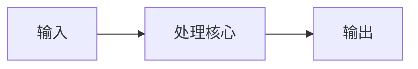

# 设计思路

## 1. 问题背景

说明要解决什么问题，使用场景是什么，为什么值得做。

## 2. 总体架构

用文字或 Mermaid 描述数据流、控制流和模块边界。

## 3. 模块划分

| 模块 | 职责 | 输入 | 输出 | 时钟/复位 |
|---|---|---|---|---|
| module_name | 待填写 | 待填写 | 待填写 | 待填写 |

## 4. 关键设计决策

### 4.1 决策一

- 备选方案：
- 选择结果：
- 选择原因：
- 代价或限制：

## 5. 时序、CDC 和复位

说明时钟域、跨时钟信号、同步器、FIFO、复位释放方式和约束策略。

## 6. 资源和功耗考虑

记录 LUT/FF/BRAM/DSP、RAM/Flash、CPU 占用、采样率、功耗等预期。

## 7. 风险与未决问题

- [ ] 待验证问题
